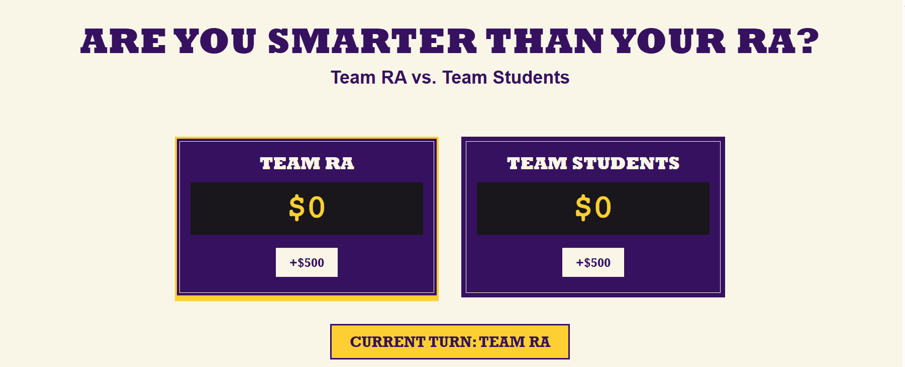
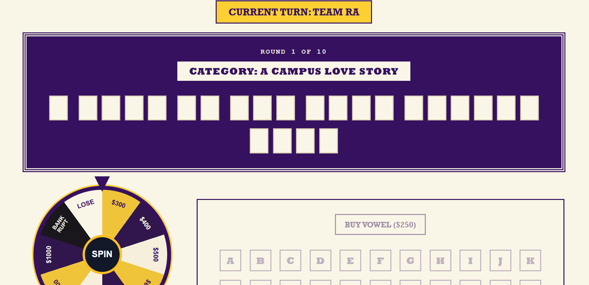
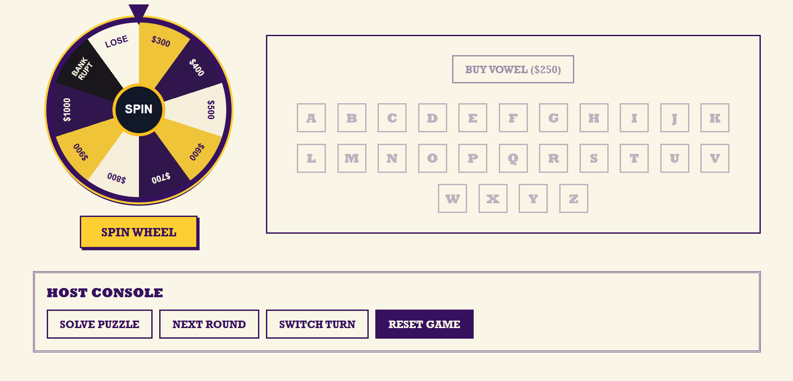

# Are You Smarter Than Your RA?

A host-operated word-puzzle game built for a resident community event at LSU. Team RA and Team Students compete by spinning a prize wheel, guessing letters, and solving campus-themed puzzles.

The interface combines retro television game-show styling with a purple-and-gold campus scoreboard.

## Features

- Ten puzzles inspired by campus life and residence life.
- Animated wheel with eight monetary values, BANKRUPT, and LOSE A TURN.
- Letter keyboard that disables previously guessed letters.
- Automatic consonant scoring and $250 vowel purchases.
- Two-team scoreboard with an active-team highlight.
- Host controls for revealing answers, advancing rounds, adjusting scores, switching turns, and resetting the game.
- Final results showing the winning team or a tie.
- Responsive layout that stacks the wheel and keyboard on smaller screens.

## How to Play

One host operates the application on a shared screen. Teams give their guesses and solutions out loud.

1. Spin the wheel, then select a consonant.
2. Each matching letter earns the wheel value. Correct guesses keep the turn; incorrect guesses pass it.
3. A team with enough points can buy a vowel for $250. The cost applies even if the vowel is absent.
4. BANKRUPT clears the current team's total and passes the turn. LOSE A TURN passes control without changing scores.
5. The host judges spoken solutions and selects **Solve Puzzle** to reveal the answer.
6. Scores carry between rounds. After the final puzzle, the host selects **End Game** to display the winner.

The **+$500** buttons allow host-awarded bonuses. Solving a puzzle does not automatically award a bonus.

## Technologies

- React
- JavaScript and JSX
- CSS, including Grid, Flexbox, and transitions
- Vite
- Node.js and npm
- ESLint
- Git and GitHub

## Run Locally

Install a Node.js version supported by the project's Vite version, then run:

```bash
git clone https://github.com/aidanwsportfolio/are-you-smarter-than-your-ra.git
cd are-you-smarter-than-your-ra
npm ci
npm run dev
```

Open the Local address printed in the terminal. Keep the terminal running while using the app.

## Development Checks

```bash
npm run lint
npm run build
```

To preview the production build locally:

```bash
npm run preview
```

## Project Structure

```text
src/
  App.jsx     Game interface, puzzle data, and gameplay logic
  App.css     Game styling and responsive layouts
  index.css   Base styles
  main.jsx    React entry point
```

## Customization

Puzzle categories and answers are defined in the `puzzles` array in `src/App.jsx`. Wheel outcomes are defined in `wheelValues` in the same file.

## Current Scope

This is a shared-screen event application. It does not provide online multiplayer, accounts, or saved game progress. Refreshing the page resets the game.

The application runs locally; a public demo has not yet been deployed.

## Screenshots

### Team Scoreboard



### Puzzle Board



### Wheel and Host Controls

